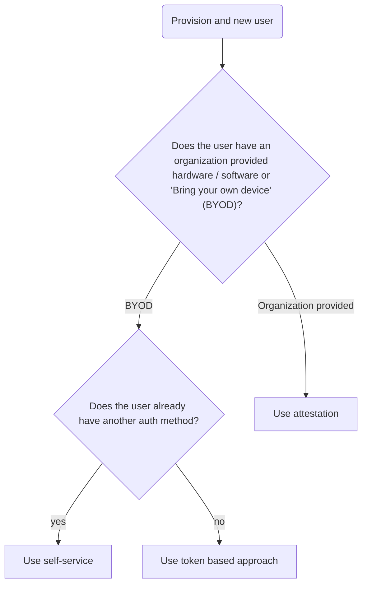

# FIDO2 Auth Plugin

## Configure

```bash
bao write auth/passkey/config \
    relying_party_id=example.com \
    relying_party_origins=https://login.example.com
```

## How to onboard a new users

For onboarding the are three different options, the following chart will help
you find the right one for your org. Details on each mode can be found below.



### Self-Service <a name="provision-self-service"></a>

> [!WARNING]
> Implementation is work-in-progress

To allow self-service, an identity admin needs to:

- Find the entity id of the target user (or create an entity, if the user never
  logged-in before.
- Find the fido2 mounts accessor.
- Create an alias for the fido2 mounts accessor mapping to the same entity.

Example when using userpass for user "alice" and mounting the fido2 plugin at "passkey":

```bash
USERPASS_ACCESSOR=$(bao read --field=accessor sys/auth/userpass)
FIDO2_ACCESSOR=$(bao read --field=accessor sys/auth/passkey)

ENTITY_ID=$(bao write --field=id identity/lookup/entity \
    alias_mount_accessor=$USERPASS_ACCESSOR \
    alias_name=alice)

bao write identity/entity-alias \
    canonical_id=$ENTITY_ID \
    mount_accessor=$FIDO2_ACCESSOR \
    name=alice
```

### Single use tokens <a name="provision-token"></a>

> [!CAUTION]
> Not yet implemented!

### Attestation <a name="provision-attestation"></a>

> [!CAUTION]
> Not yet implemented!

## Limitations

- If users are allowed to self-enroll, a leaked token can be turned into
  persistent access by an attacker. Usually a leaked token would expire (or get
  revoked) at some point. But an attacker can now use the token to self-enroll
  their own Passkey. In other implementations (e.g. GitHub), this is combated by
  requiring re-authentication for enrolling a Passkey. For a plugin, there is
  currently no way to re-authenticate a user.

- Credential IDs aren't checked for uniqueness across users. This would
  complicate the implementation for no gain. This is a deviation from the
  [webauthn Level 3
  spec](https://www.w3.org/TR/webauthn-3/#sctn-registering-a-new-credential),
  which recommends (but does not require) such a check in chapter 7.1 step 26.
  The attack outlined in the rationale for this step is mitigated by different
  means: The lookup of the public key during login uses both the credential id
  and the user handle provided by the potential victims authenticator.

- Renaming or deleting an alias will not work as one might expect:

  - A deleted alias will not remove the enrolled keys from storage, the user can
    still login and an empty alias (with default permissions) will be created.
  - A renamed alias will not be able to login: when the user logs in next time a
    fresh alias with the old name will be created.

  The same behaviour will be seen with the built-in auth methods like userpass.
  In the general case, OpenBao is not necessarily able to rename or delete a
  user (e.g. it can't rename an OIDC user in the identity provider or revoke a
  TLS certificate it didn't issue).

## TODOs

- There is no way of listing and deleting enrolled keys (neither for the user
  nor for the admin).
- User handle should not be the alias name -> change to a salted hash. See
  [webauthn Level 3 spec](https://www.w3.org/TR/webauthn-3/#user-handle)
- Make sure it works well with read-enabled standbys (i.e. implement the
  `Invalidate` hook).
- Check / store the signature counter
- Store additional metadata, like backup flags
- Let users assign a names to their keys
- Add security headers (like Content-Security-Polices) to the UI.
- Streamline the request paths and operations (`created` vs `read`) and use
  request body instead of query string for all sensitive values.
- The "challenge" is currently abused to carry metadata, this could be moved out
  and the JavaScript side would be responsible for sending it back. It should
  still be part of the HMAC.

## Dev Setup

See [DEV.md](./DEV.md)
